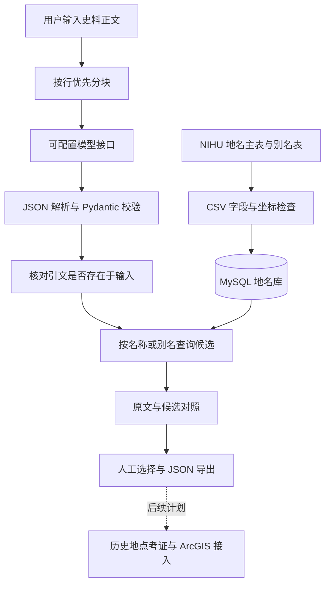

# 技术流程与实现边界

## 数据流

模型侧负责提取信息，地名库负责提供候选坐标。模型不直接生成坐标。JSON 导出保存在浏览器下载文件中；本版没有把抽取结果或核验结果写回 MySQL。

## 文本分块与模型调用

`app/extraction.py` 优先保留完整文本行；单行超过阈值时硬切，默认上限 1,500 字符，可配置。每块顺序调用一次模型。请求上限为 30,000 字符；客户端超时和 SDK 自动重试可能带来额外请求费用。

分块仅控制输入长度，并未证明提高准确率；硬切可能割裂日期、人物指代或段落上下文。本版无重叠分块、并发调度或跨块指代消解。`segment_index` 标明来源块，`date_index` 是输出顺序，不是历史日期标准化结果。

通过 OpenAI Python SDK 的兼容接口调用 ModelScope，默认模型 ID 保留 `MiniMax/MiniMax-M2.5`。模型返回纯 JSON 后再本地校验，不假定服务商支持强制 JSON Schema 输出。拒绝无法在输入中找到的原文引文，但无法识别所有语义误读。模型返回的原文仍必须由研究者检查。

分块失败会保留失败索引；部分成功状态为 `partial`，全失败为 `failed`。不会把解析失败伪装为空结果成功；数据服务失败会保留成功抽取的记录，标明匹配失败。

## MySQL 地名库

使用原始数据 ID 作为主键，不以名称做主键。名称与别名采用 UTF-8 日文可用的 `utf8mb4` 和二进制排序规则；不自动替换新旧字体、简繁或异体字。PyMySQL 对查询值进行参数绑定。

| 表 | 内容 |
| --- | --- |
| `places` | 原始 ID、名称、属性、形状、经纬度及第二端点、出处、出处详情、备注 |
| `place_aliases` | 别名 ID、对应主表 ID、别名及种别 |

公开数据还有上级地名等关系表，本版尚未导入；不声称实现历史行政层级筛选。导入保留原始空坐标及线要素第二端点，缺失值不替换为 0。当前仅按名称或已导入的别名查找，不包含模糊匹配和向量检索。

每个地名表达返回多个以 ID 区分的候选。至多返回 50 条并标明 `truncated`；候选数量超过上限时界面列表不完整。任何候选均不会自动成为确定地点，单一候选也须核验。

## 接口

| 接口 | 用途 |
| --- | --- |
| `GET /` | 本地核验页面 |
| `GET /api/health` | 仅检查 Web 进程，不检查模型或数据库 |
| `GET /api/demo` | 固定人工演示，不使用模型或数据库 |
| `POST /api/extract` | 输入 `{"text":"史料正文"}`，抽取并查询候选 |
| `GET /api/geocode?name=…` | 单独查询地名或别名候选 |
| `GET /docs` | FastAPI 自动接口文档 |

导出中 `manual_selections` 保存记录序号、原地点表达、候选 ID、候选内容和 `manual_selection_for_review` 状态。JSON 中仍保留全部返回候选；选择不修改原模型输出。当前没有多人协作、服务器持久保存和跨会话核验恢复。

## 明确未实现

ArcGIS 接入、历史地点自动消歧、历史京都边界论证、OCR 获取、训练／微调、RAG、模型准确率评估、抽取结果数据库持久化、生产部署鉴权。运行入口默认只绑定本机；公开演示站点需要另行设计访问控制和数据处理方式。
