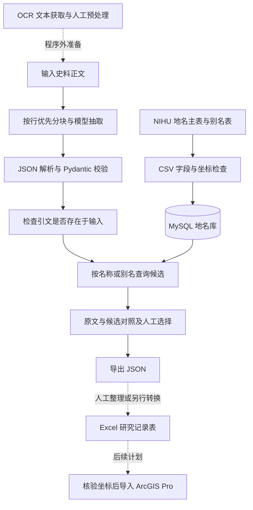

# 技术流程与实现说明

## 研究流程与程序实现

研究目标是从史料中整理犬类相关事例，关联可靠的历史地点，最终用于空间分析。当前程序实现文本输入、信息抽取、地名候选查询与核验结果导出；OCR 获取、研究用 Excel 表格整理及 ArcGIS 导入分别处于程序外或后续计划中。

MySQL 保存用于检索的地名及别名底库，Excel 用于整理研究事例。模型不直接生成坐标，候选坐标来自地名库。当前程序不会把抽取结果或人工选择写回 MySQL，也不提供 Excel 自动导出或 ArcGIS 接入。

## 文本分块与模型调用

`app/extraction.py` 优先保留完整文本行；单行超过阈值时硬切，默认上限为 1,500 字符，可通过 `CHUNK_CHARS` 配置。每块顺序调用一次模型，单次提交的全文上限为 30,000 字符；超时和 SDK 自动重试可能产生额外调用。

分块用于控制输入长度，其对准确率的影响尚未评估。硬切可能割裂日期、人物指代或段落上下文；当前未实现重叠分块、并发调度或跨块指代消解。`segment_index` 标明来源文本块，`date_index` 表示输出顺序，不是转换后的历史日期。

模型通过 OpenAI Python SDK 的兼容接口调用，默认入口为 ModelScope，默认模型 ID 为 `MiniMax/MiniMax-M2.5`。服务入口、模型名称和密钥均通过本地 `.env` 配置。是否能够在线调用，取决于相应服务的模型可用性和账号权限。

当前提示词按日提取日期、天气、地点表达、人物与行为、事件及关键词，不自动判断事件是否属于犬类研究样本。研究相关性需要人工筛选；联网检索与历史地点消歧也未包含在抽取接口中。

## 输出校验与异常处理

模型按提示词返回 JSON，程序随后进行解析与 Pydantic 字段校验，不依赖服务商提供强制 JSON Schema 输出。`original_text` 必须是在对应输入块中能够找到的连续片段，否则该块校验失败。

字段校验和引文存在检查不等于语义核验。人物身份、事件解释、日期归属和地点含义仍需对照史料判断；当前也不会自动识别输入中的正文与后加注释，输入前应先整理。

分块失败会记录失败索引。部分文本块成功时返回 `partial`，全部失败时返回 `failed`；未抽取出记录也不能据此断定史料中没有相关信息。若模型抽取成功、数据库查询失败，程序保留抽取结果并标记匹配失败，便于分别排查。

## MySQL 地名库与候选检索

导入时使用源数据 ID 作为主键，不以名称作为主键。名称与别名使用 `utf8mb4` 和二进制排序规则，不自动归一化新旧字体、简繁或异体字。PyMySQL 使用参数绑定传递查询值。

| 表 | 内容 |
| --- | --- |
| `places` | 原始 ID、名称、属性、形状、经纬度及第二端点、出处、出处详情、备注 |
| `place_aliases` | 别名 ID、对应地名 ID、别名及种别 |

程序按名称或已导入的别名查询，不包含模糊匹配、历史行政层级筛选或经纬度范围筛选。公开数据中的上级地名等关系表尚未导入。导入保留空坐标和线要素第二端点，不把缺失值替换为 0。

同名候选按地名 ID 区分，最多返回按 ID 排序的前 50 条，并通过 `truncated` 标明是否还有未显示的候选。这个顺序不是可信度排序；即使只返回一条，也不能据此自动确认历史地点。

## 核验记录与 Excel 字段设计

页面支持查看原文与候选、选择候选并导出 JSON。导出数据中的 `manual_selections` 保存记录序号、原地点表达、候选 ID、候选内容，以及 `manual_selection_for_review` 状态。选择不会改写模型提取的地点表达，也不代表完成历史考证。

研究整理时，可在 Excel 中按事件与地点的对应关系组织记录。以下是**研究表格的字段设计**，与程序当前返回的 JSON 字段、MySQL 地名表字段不是同一套结构：

| Excel 字段 | 用途与整理要求 |
| --- | --- |
| ID | 研究记录编号，与地名库的候选 ID 分开记录 |
| Name | 史料中的地点表达；如另设规范名称，应保留原始表述 |
| Longitude、Latitude | 经人工核验后采用的坐标；无法确定时留空 |
| Period | 史料纪日或研究时段，保留原始日期表述，不自动推算公历日期 |
| Category | 依据研究问题人工确定的事例类别 |
| EventSummary | 经原文核对的事件概要 |
| Source、OriginalText | 史料出处、原文位置及对应片段 |
| LocationStatus | 地点核验状态，例如待查证、无法定位、已核验 |
| PlaceID、LocationEvidence | 如采用地名库候选，记录候选 ID、坐标出处与选择依据 |

当前程序导出的是嵌套 JSON，需要人工整理或另行转换后再用于 Excel；尚未实现 `.xlsx`／CSV 导出及上述研究表格的自动生成。一个日期条目可能涉及多个事件和地点，不能默认将该条目中所有事件与所有地点逐一组合，也不能直接生成已定位的 GIS 点。

## 接口

| 接口 | 用途 |
| --- | --- |
| `GET /` | 本地核验页面 |
| `GET /api/health` | 检查 Web 进程，不检查模型或数据库 |
| `GET /api/demo` | 固定人工演示，不调用模型或数据库 |
| `POST /api/extract` | 输入 `{"text":"史料正文"}`，抽取信息并查询地名候选 |
| `GET /api/geocode?name=…` | 单独查询地名或别名候选 |
| `GET /docs` | FastAPI 自动接口文档 |

当前没有服务器端核验记录持久化、多人协作和导出结果重新载入功能。导出的 JSON 应在本地保存；刷新页面后，未导出的选择不会保留。

## 后续计划与研究限制

ArcGIS Pro 导入拟以经过历史地点核验的研究记录为基础。可定位记录需要明确坐标含义与坐标参考系，再转换为空间要素；无法定位的记录保留为空。地名库中的代表点或线要素端点不能直接当作事件发生点。

OCR 获取、Excel 自动导出、历史地点自动消歧、历史京都边界论证、模型准确率评估，以及 ArcGIS 导入均未集成到当前程序中。研究范围调整及未继续接入 ArcGIS 的原因见[项目目标与研究复盘](project-history.md)。本项目作为本地研究原型运行，公开部署的访问控制需另行设计。
