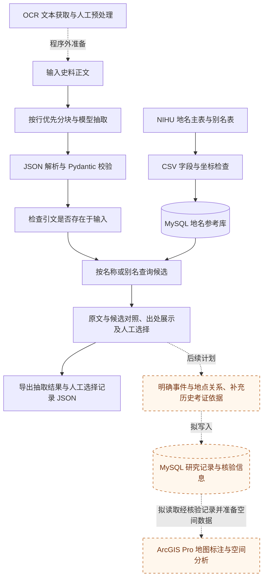

# 技术流程与实现说明

## 研究流程与程序实现

项目目标是从史料中整理犬类相关事例，关联历史地点，并将结构化研究记录存入 MySQL，供后续空间分析使用。

MySQL 在整体设计中承担两类数据的存储：

- **地名参考数据：**公开历史地名及别名数据，用于名称匹配与坐标候选查询。目前已提供建表、导入和查询功能。
- **史料研究数据：**从史料中提取的日期、人物、地点与事件，以及人工选择和历史地点核验信息。这部分入库功能尚未实现。

下图中，实线表示当前程序已有的处理步骤；“程序外准备”表示输入前完成的工作；橙色节点和标有“后续计划”“拟写入”“拟读取”的虚线表示尚未实现的后续流程。

当前程序流程为：**史料文本输入 → 文本分块与模型抽取 → JSON 解析及字段校验 → 查询 MySQL 地名参考库 → 原文与候选对照 → 人工选择及 JSON 导出。**

计划补充的后续流程为：**整理事件与地点的对应关系及考证依据 → 将结构化研究记录及核验信息写入 MySQL → 读取经过核验的记录并准备空间数据 → 接入 ArcGIS Pro。**

图中的两个 MySQL 节点表示不同用途的数据表，并不要求分别部署两套数据库。目前数据库中只有地名及别名参考表，研究记录及核验信息的存储仍需补充相应数据表、写入接口与状态保存机制。

JSON 是当前接口返回和文件导出的格式；研究记录入库是计划的数据存储环节。OCR 文本获取在程序外完成，当前工程接收准备好的史料正文。

## 文本分块与模型调用

`app/extraction.py` 优先保留完整文本行；单行超过阈值时硬切，默认上限为 1,500 字符，可通过 `CHUNK_CHARS` 配置。每块顺序调用一次模型，单次提交的全文上限为 30,000 字符；超时和 SDK 自动重试可能产生额外调用。

分块用于控制输入长度，其对准确率的影响尚未评估。硬切可能割裂日期、人物指代或段落上下文；当前未实现重叠分块、并发调度或跨块指代消解。`segment_index` 标明来源文本块，`date_index` 表示输出顺序，不是转换后的历史日期。

模型通过 OpenAI Python SDK 的兼容接口调用，默认入口为 ModelScope，默认模型 ID 为 `MiniMax/MiniMax-M2.5`。服务入口、模型名称和密钥均通过本地 `.env` 配置。是否能够在线调用，取决于相应服务的模型可用性和账号权限。

当前提示词按日提取日期、天气、地点表达、人物与行为、事件及关键词，不自动判断事件是否属于犬类研究样本。研究相关性需要人工筛选；联网检索与历史地点消歧也未包含在抽取接口中。

## 输出校验与异常处理

模型按提示词返回 JSON，程序随后进行解析与 Pydantic 字段校验，不依赖服务商提供强制 JSON Schema 输出。`original_text` 必须是在对应输入块中能够找到的连续片段，否则该块校验失败。

字段校验和引文存在检查不等于语义核验。人物身份、事件解释、日期归属和地点含义仍需对照史料判断；当前也不会自动识别输入中的正文与后加注释，输入前应先整理。

分块失败会记录失败索引。部分文本块成功时返回 `partial`，全部失败时返回 `failed`；未抽取出记录也不能据此断定史料中没有相关信息。若模型抽取成功、数据库查询失败，程序保留抽取结果并标记匹配失败，便于分别排查。

## MySQL 地名库与候选检索

导入时使用源数据 ID 作为主键，不以名称作为主键。名称与别名使用 `utf8mb4` 和二进制排序规则，不自动归一化新旧字体、简繁或异体字。PyMySQL 使用参数绑定传递查询值。

| 表 | 内容 |
| --- | --- |
| `places` | 原始 ID、名称、属性、形状、经纬度及第二端点、出处、出处详情、备注 |
| `place_aliases` | 别名 ID、对应地名 ID、别名及种别 |

程序按名称或已导入的别名查询，不包含模糊匹配、历史行政层级筛选或经纬度范围筛选。公开数据中的上级地名等关系表尚未导入。导入保留空坐标和线要素第二端点，不把缺失值替换为 0。

同名候选按地名 ID 区分，最多返回按 ID 排序的前 50 条，并通过 `truncated` 标明是否还有未显示的候选。这个顺序不是可信度排序；即使只返回一条，也不能据此自动确认历史地点。

## 人工选择记录与研究数据入库设计

页面支持查看史料原文、同名地点候选、坐标及地名数据自带的出处和备注。使用者可以选择候选，也可以保留“暂不选择”。

当前导出的 JSON 中，`manual_selections` 保存对应史料条目的序号、原地点表达、候选 ID、候选内容和 `manual_selection_for_review` 状态。选择不会改写模型提取的地点表达，也不代表完成历史地点考证。程序尚未提供填写研究者考证理由、保存核验结论或将选择结果写入 MySQL 的功能。

后续计划将史料研究记录与核验信息存入 MySQL，字段设计包括：

| 字段 | 用途 |
| --- | --- |
| ID | 研究记录编号，与地名库候选 ID 分开保存 |
| Name | 史料中的地点表达；如另设规范名称，应同时保留原始表述 |
| Longitude、Latitude | 经核验后采用的坐标；无法确定时留空 |
| Period | 史料纪日或研究时段，保留原始日期表述 |
| Category | 依据研究问题确定的事例类别 |
| EventSummary | 经原文核对的事件概要 |
| People | 相关人物及其行为 |
| Source、OriginalText | 史料出处、原文位置及对应片段 |
| LocationStatus | 地点核验状态，如待查证、无法定位、已核验 |
| PlaceID | 采用的地名库候选 ID |
| LocationEvidence | 坐标出处、定位理由及相关研究文献依据 |

上述内容属于待实现的入库设计，具体表结构及记录之间的关联仍需完善。地名数据自带的出处应与研究者补充的考证依据分别保存。

一个日期条目可能涉及多个事件和地点，入库前需要明确事件与地点的对应关系，不能将同一条目中的所有事件与所有地点直接组合。

后续 ArcGIS Pro 接入将以经过核验的研究记录为基础，明确坐标含义与坐标参考系后，再生成空间要素。地名库中的代表点或线要素端点不能直接视为事件发生点。

## 接口

| 接口 | 用途 |
| --- | --- |
| `GET /` | 本地核验页面 |
| `GET /api/health` | 检查 Web 进程，不检查模型或数据库 |
| `GET /api/demo` | 固定人工演示，不调用模型或数据库 |
| `POST /api/extract` | 输入 `{"text":"史料正文"}`，抽取信息并查询地名候选 |
| `GET /api/geocode?name=…` | 单独查询地名或别名候选 |
| `GET /docs` | FastAPI 自动接口文档 |

当前没有服务器端核验记录持久化、多人协作和导出结果重新载入功能。导出的 JSON 应在本地保存；刷新页面后，未导出的选择不会保留。

## 后续计划与研究限制

ArcGIS Pro 导入拟以经过历史地点核验的研究记录为基础。可定位记录需要明确坐标含义与坐标参考系，再转换为空间要素；无法定位的记录保留为空。地名库中的代表点或线要素端点不能直接当作事件发生点。

OCR 获取、研究记录及核验信息写入 MySQL、历史地点自动消歧、历史京都边界论证、模型准确率评估，以及 ArcGIS 导入均未集成到当前程序中。研究范围调整及未继续接入 ArcGIS 的原因见[项目目标与研究复盘](project-history.md)。本项目作为本地研究原型运行，公开部署的访问控制需另行设计。
